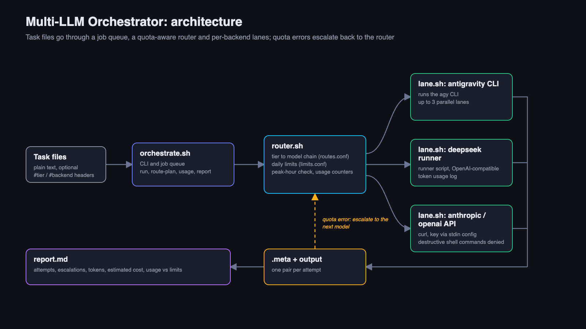
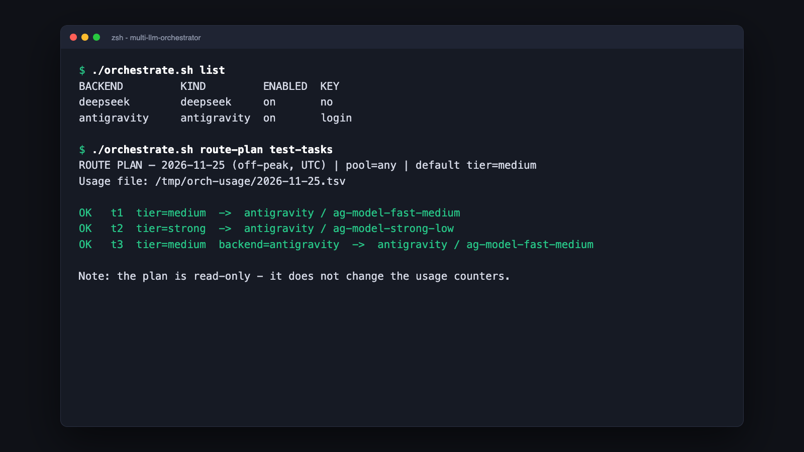
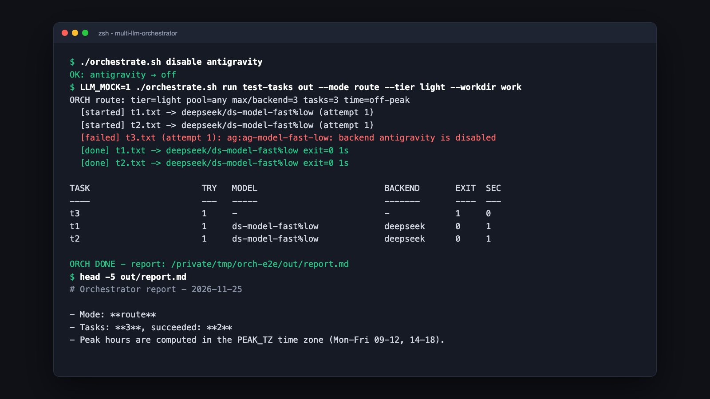
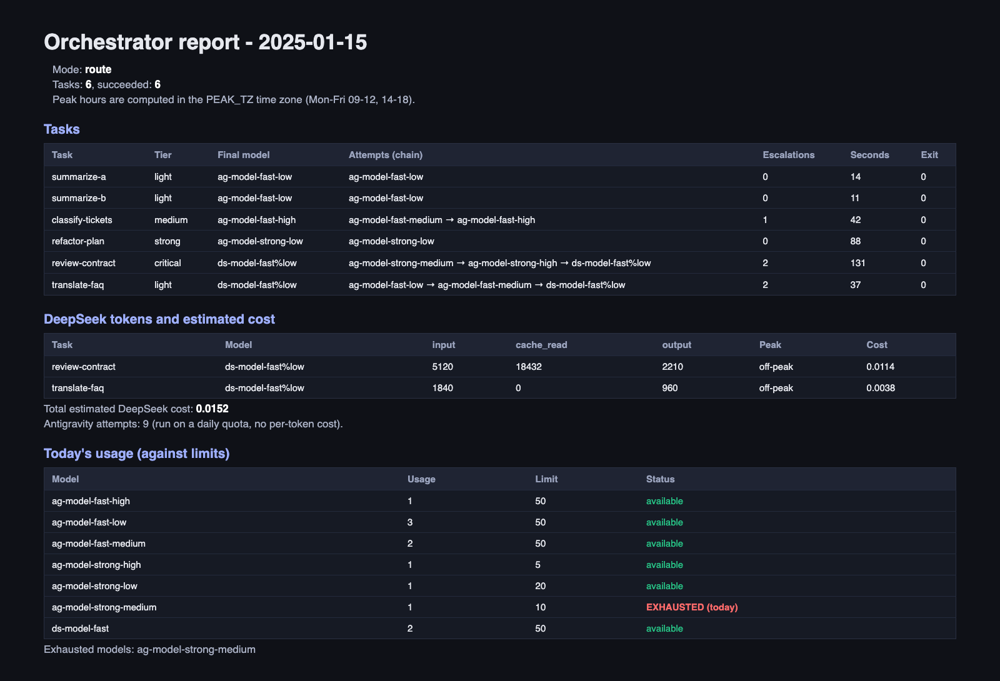
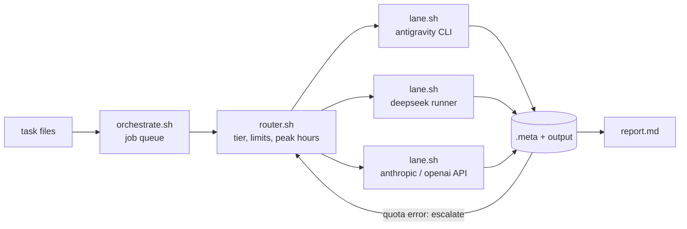

# Multi-LLM Orchestrator

**Fan a folder of task files out to several LLM backends in parallel, route each task through a quota-aware model chain, and get a run report.**

[](https://github.com/Zeusmma/multi-llm-orchestrator/actions/workflows/test.yml)
[](LICENSE)




A small zsh toolkit. Portfolio sample: provider and model names in the config files are examples.

## Contents

- [At a glance](#at-a-glance)
- [Quick start](#quick-start)
- [Set up with an AI assistant](#set-up-with-an-ai-assistant)
- [Screenshots](#screenshots)
- [Features](#features)
- [Architecture](#architecture)
- [Backends](#backends)
- [Configuration](#configuration)
- [Safety notes](#safety-notes)
- [Project structure](#project-structure)
- [FAQ](#faq)
- [Limitations](#limitations)
- [Contributing](#contributing)
- [License](#license)

## At a glance

| | |
|---|---|
| Lines of code | Shell 1,559 · YAML 32 (total 1,591) |
| Checks | 4 CI stages: syntax checks of all scripts, route plan, dry run, offline end-to-end run with the mock runner |
| Platforms | macOS and Linux (zsh 5.x); Windows via WSL |
| Dependencies | 0 packages: zsh, python3 (standard library) and curl |
| Modes | `split`, `dual`, `tri`, `route` |
| Backend kinds | `deepseek` runner (OpenAI-compatible), `antigravity` CLI, `anthropic` API, `openai` API |

## Quick start

```sh
git clone https://github.com/Zeusmma/multi-llm-orchestrator.git && cd multi-llm-orchestrator
./scripts/setup.sh                   # checks tools, creates .env, runs an offline end-to-end test
./orchestrate.sh route-plan test-tasks
```

Run for real after putting your key in `.env` (`set -a; . ./.env; set +a`):

```sh
./orchestrate.sh run test-tasks out --mode route --tier medium --workdir work
./orchestrate.sh usage
```

Try it without any API key or CLI: disable the `antigravity` backend (this edits `backends.conf`; undo with `enable antigravity`) and use the mock runner. `test-tasks/t3.txt` pins the `antigravity` backend, so it is reported as failed in this mode.

```sh
./orchestrate.sh disable antigravity
LLM_MOCK=1 ./orchestrate.sh run test-tasks out --mode route --tier light --workdir work
```

## Set up with an AI assistant

[`AI_SETUP.md`](AI_SETUP.md) has a copy-paste prompt and a numbered checklist for Claude Code, Cursor or any AI coding assistant: prerequisites, the offline self-test, connecting a backend, verification with expected output, troubleshooting and cleanup. The assistant is told to ask you for every key and never to invent one.

## Screenshots

| Route plan | Offline end-to-end run |
|---|---|
|  |  |



*The report above is the illustrative [docs/sample-report.md](docs/sample-report.md); the numbers are fictional.*

## Features

- **split**: distributes tasks round-robin over enabled backends.
- **dual / tri**: sends every task to 2 or 3 backends and builds a `<task>.compare.md` side-by-side file with an automatic summary.
- **route**: picks a model per task by difficulty tier (`light|medium|strong|critical`) from `routes.conf`, respects daily per-model limits from `limits.conf`, skips models marked exhausted, avoids provider peak hours for `@offpeak` entries, and escalates to the next model in the chain when a lane fails or hits a quota error (HTTP 429, `RESOURCE_EXHAUSTED`, rate limit). Up to 3 parallel lanes per backend.
- Writes `<out-dir>/report.md` with attempts, escalations, token usage and estimated cost (see [docs/sample-report.md](docs/sample-report.md)).
- Dry-run and `route-plan` commands show what would run without running anything.

## Architecture



A task file is plain text. Optional header lines (first 5 lines): `#tier:`, `#backend:`, `#model:`, `#pool:`.

## Backends

Backends of kind `deepseek` call a runner script (`DEEPSEEK_AGENT`). The default is the bundled [examples/openai-compatible-runner.sh](examples/openai-compatible-runner.sh), which posts to any OpenAI-compatible `/chat/completions` endpoint (`LLM_BASE_URL`, default `https://api.deepseek.com/v1`; key from `DEEPSEEK_API_KEY`) and writes the token usage that feeds the report. Set `LLM_MOCK=1` for an offline demo. Backends of kind `antigravity` need the `agy` CLI installed and logged in (`AGY_BIN` to override the path). Provider and model names in the config files are examples; edit them for your accounts.

## Configuration

Environment variables:

| Variable | Purpose |
|---|---|
| `DEEPSEEK_API_KEY` | Key for the `deepseek` backend (used by the runner script) |
| `LLM_BASE_URL`, `LLM_MODEL`, `LLM_MOCK` | Bundled runner only: endpoint, model-name override, offline mock mode |
| `ORCH_<NAME>_API_KEY` | Key for each `anthropic` / `openai` kind backend added with `add-api` |
| `ORCH_WORK_ROOT` | Default work dir; also the only place the permission-skip retry is allowed (default `$HOME/orch-work`) |
| `ORCH_PREFIX_FILE` | Optional text file prepended to every prompt |
| `DEEPSEEK_AGENT`, `DEEPSEEK_LOG_DIR`, `AGY_BIN` | Paths to the runner, its token logs, and the `agy` binary |
| `PEAK_TZ` | Time zone of the provider's peak window (default UTC) |
| `ORCH_NOW`, `ORCH_USAGE_DIR` | Testing: freeze the clock, redirect usage counters |

## Safety notes

- API keys come only from environment variables. They are never written to logs; the OpenAI-kind lane passes the Authorization header to curl through stdin config so it does not appear in the process list.
- The `--dangerously-skip-permissions` retry for the `agy` CLI is only attempted when the work dir is inside `ORCH_WORK_ROOT`.
- The Anthropic-kind lane denies destructive shell commands (`rm`, `rmdir`, `git clean`, `find -delete`).
- The `deepseek` and `antigravity` backends and the model names are examples of how backends plug in. Quotas and prices in the config files are illustrative.
- Logs, usage counters and outputs are git-ignored; check them before sharing.

## Project structure

| File | Role |
|---|---|
| `orchestrate.sh` | CLI and dispatcher (`run`, `route-plan`, `usage`, `list`, `enable`, `disable`, `add-api`), job queue, report writer |
| `router.sh` | Routing library: peak-hour detection, usage counters, limit checks, chain selection, task header parsing |
| `lane.sh` | Runs one task on one backend (`deepseek`, `antigravity` CLI, Anthropic-compatible or OpenAI-compatible HTTP API) and writes a `.meta` file |
| `backends.conf` | Backend definitions: `name\|kind\|model_light\|model_strong\|extra\|on/off` |
| `routes.conf` | Tier to model chain, e.g. `light\|ag:ag-model-fast-low\|ds:ds-model-fast%low` |
| `limits.conf` | Daily per-model limits (shell globs, first match wins) |
| `examples/openai-compatible-runner.sh` | Minimal runner for the `deepseek` backend kind (curl to an OpenAI-compatible API) |
| `scripts/setup.sh` | One-command prerequisite check, `.env` creation and offline mock end-to-end test |
| `AI_SETUP.md` | Prompt and checklist for AI-assisted setup |
| `docs/sample-report.md` | Example run report |
| `test-tasks/` | Sample task files |

## FAQ

**Can I use it without the `agy` CLI?** Yes. Run `./orchestrate.sh disable antigravity`; the router skips disabled backends and falls through to the next model in the chain.

**How do I add another provider?** `./orchestrate.sh add-api <name> anthropic|openai <base_url> <model_light> <model_strong>`, then export `ORCH_<NAME>_API_KEY`.

**Does a dry run call any model?** No. `--dry-run` and `route-plan` only print what would run, and `route-plan` does not change usage counters.

**Where do usage counters live?** In `usage/` (override with `ORCH_USAGE_DIR`). They are git-ignored and reset per day.

## Limitations

- Quotas, prices and model names are illustrative placeholders; edit `limits.conf`, `routes.conf` and the price table in `orchestrate.sh`.
- zsh only; no native Windows support (use WSL).
- Planned: a pluggable price table, JSON output for the report, retries with backoff for transient network errors.

## Contributing

Issues and pull requests are welcome, see [CONTRIBUTING.md](CONTRIBUTING.md). Report security problems as described in [SECURITY.md](SECURITY.md). Release notes are in [CHANGELOG.md](CHANGELOG.md).

## License

MIT, see [LICENSE](LICENSE).
